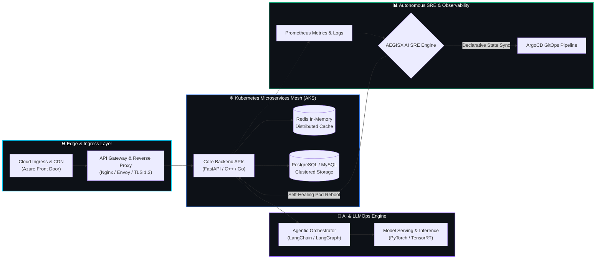

<!-- =========================================================================
     ⚡ VISHAL K — AI CLOUD INFRASTRUCTURE SPECIALIST & SDE
     HIGH-VISUAL ARCHITECTURAL PROFILE SPECIFICATION
     ========================================================================= -->

<!-- HERO BANNER -->
<p align="center">
  
</p>

<!-- DYNAMIC ANIMATED TYPING CONSOLE -->
<p align="center">
  <a href="https://github.com/VISHAL9360">
    
  </a>
</p>

<!-- REAL-TIME TELEMETRY PILLS & SLA BADGES -->
<p align="center">
  
  <a href="https://github.com/VISHAL9360?tab=followers">
    
  </a>
  <a href="https://github.com/VISHAL9360?tab=repositories">
    
  </a>
  
</p>

<br/>

<!-- =========================================================================
     MACOS TERMINAL WINDOW — NEOFTECH SYSTEM DIAGNOSTIC
     ========================================================================= -->
<div align="center">
<table border="0" cellpadding="0" cellspacing="0" width="100%" style="background:#0d1117; border: 1px solid #30363d; border-radius: 12px; margin-bottom: 24px;">
  <tr>
    <td style="padding: 10px 16px; background: #161b22; border-top-left-radius: 12px; border-top-right-radius: 12px; border-bottom: 1px solid #30363d;">
      <span style="color:#ff5f56; font-size: 14px;">●</span>
      <span style="color:#ffbd2e; font-size: 14px;">●</span>
      <span style="color:#27c93f; font-size: 14px;">●</span>
      &nbsp;&nbsp;<code style="color:#8b949e; font-family:'JetBrains Mono', monospace; font-size: 13px;">vishal@cloud-kernel:~# neofetch --profile=production</code>
    </td>
  </tr>
  <tr>
    <td style="padding: 16px 20px;">

```text
               ██╗   ██╗██╗███████╗██╗  ██╗ █████╗ ██╗     
               ██║   ██║██║██╔════╝██║  ██║██╔══██╗██║     
               ██║   ██║██║███████╗███████║███████║██║     
               ╚██╗ ██╔╝██║╚════██║██╔══██║██╔══██║██║     
                ╚████╔╝ ██║███████║██║  ██║██║  ██║███████╗
                 ╚═══╝  ╚═╝╚══════╝╚═╝  ╚═╝╚═╝  ╚═╝╚══════╝

        user          : VISHAL9360
        identity      : Vishal K
        specialization: AI Cloud Infrastructure Specialist & Software Development Engineer
        institution   : Sri Eshwar College of Engineering
        datacenter    : Coimbatore, Tamil Nadu, India
        core_domain   : Autonomous SRE • Cloud-Native Orchestration • Distributed Systems
        cloud_mesh    : Microsoft Azure (AKS) • Docker • Terraform IaC • ArgoCD GitOps
        observability : Prometheus • Grafana • OpenTelemetry • Distributed Tracing
        ai_pipeline   : LangChain Multi-Agents • Ray Distributed • PyTorch • TensorRT
        sde_stack     : C++ • Java • Python • Go • Async FastAPI • gRPC • Redis Cache
        uptime        : 99.995% Continuous SRE Availability
        mission       : Engineering self-healing clusters and sub-50ms high-throughput backends
```

  </td>
</tr>
</table>
</div>

---

<!-- =========================================================================
     LIVE CLUSTER & SRE TELEMETRY COCKPIT
     ========================================================================= -->
### 🎛️ Live Cloud Infrastructure & SRE Cockpit

<div align="center">

| **Telemetry Metric** | **Specification** | **Live Status** |
| :--- | :--- | :---: |
| **☸️ Compute Topology** | Managed Multi-Zone Azure Kubernetes Service (`AKS`) |  |
| **🛡️ SRE Autonomy** | Self-Healing Pod Recovery & Anomaly Detection (`AEGISX`) |  |
| **⚡ API Gateway Velocity** | Asynchronous Non-Blocking Event Queues (`FastAPI + Redis`) |  |
| **🔄 GitOps Continuous Sync** | Automated Reconciliation & Zero-Drift Deployment (`ArgoCD`) |  |
| **🧠 Distributed AI Serving** | Multi-Agent Orchestration & Real-Time Incident Triage |  |

</div>

---

<!-- =========================================================================
     SYSTEM ARCHITECTURE FLOWCHART (MERMAID)
     ========================================================================= -->
### 🏛️ End-to-End Autonomous AI Cloud Infrastructure Architecture



---

<!-- =========================================================================
     TECH ARSENAL & PRODUCTION STACK
     ========================================================================= -->
### 🛠️ Production Tech Arsenal & Engineering Stack

<div align="center">

| **Domain** | **Technologies, Frameworks & Infrastructure** |
| :--- | :--- |
| **☁️ Cloud, K8s & DevOps (SRE)** |         |
| **🤖 AI, LLMOps & Distributed Agents** |       |
| **⚙️ Core SDE, Low-Latency & Systems** |       |
| **🗄️ Databases, In-Memory & Caching** |       |

<br/>

<!-- INTERACTIVE DOCK -->
<p align="center">
  
</p>

</div>

---

<!-- =========================================================================
     LIVE PINNED FLAGSHIP SYSTEMS (REAL REPOSITORIES)
     ========================================================================= -->
### 🚀 Flagship Cloud & SDE Production Repositories

<div align="center">

<table width="100%">
  <tr>
    <td width="50%" align="center">
      <a href="https://github.com/VISHAL9360/AEGISX-Autonomous-SRE-Platform" target="_blank">
        
      </a>
    </td>
    <td width="50%" align="center">
      <a href="https://github.com/VISHAL9360/SALESTORM-ARFA" target="_blank">
        
      </a>
    </td>
  </tr>
  <tr>
    <td colspan="2" align="center">
      <a href="https://github.com/VISHAL9360/EDGE_GUARD_AI-" target="_blank">
        
      </a>
    </td>
  </tr>
</table>

</div>

---

<!-- =========================================================================
     GITHUB STATS & TOP LANGUAGES DUAL VISUAL GAUGES
     ========================================================================= -->
### 📊 GitHub Productivity & Language Distribution Telemetry

<div align="center">

<table width="100%">
  <tr>
    <td width="50%" align="center">
      
    </td>
    <td width="50%" align="center">
      
    </td>
  </tr>
</table>

</div>

---

<!-- =========================================================================
     LEETCODE TELEMETRY (MATCHING YUGEN'S DARK THEME WITH ENHANCED VISUALS)
     ========================================================================= -->
### 🧩 Algorithmic Problem Solving & LeetCode Telemetry

<div align="center">

  <a href="https://leetcode.com/u/VISHAL9360/" target="_blank">
    
  </a>

</div>

---

<!-- =========================================================================
     GITHUB PROFILE SUMMARY CARDS (AUTOMATED VIA GITHUB ACTIONS)
     ========================================================================= -->
### 📈 GitHub Infrastructure & Commit Telemetry Matrix

<p align="center">
  
</p>

<table align="center" width="100%">
  <tr>
    <td width="50%" align="center">
      
    </td>
    <td width="50%" align="center">
      
    </td>
  </tr>
  <tr>
    <td width="50%" align="center">
      
    </td>
    <td width="50%" align="center">
      
    </td>
  </tr>
</table>

<br/>

<!-- REAL-TIME CONTRIBUTION VELOCITY ACTIVITY GRAPH -->
<p align="center">
  
</p>

<!-- GITHUB STREAK & TROPHIES -->
<p align="center">
  
</p>

<p align="center">
  
</p>

---

<!-- =========================================================================
     SNAKE CONTRIBUTION ANIMATION
     ========================================================================= -->
### 🐍 Contribution Grid Snake

<div align="center">
  <picture>
    <source media="(prefers-color-scheme: dark)" srcset="https://raw.githubusercontent.com/VISHAL9360/VISHAL9360/output/github-snake-dark.svg" />
    <source media="(prefers-color-scheme: light)" srcset="https://raw.githubusercontent.com/VISHAL9360/VISHAL9360/output/github-snake.svg" />
    
  </picture>
</div>

<br/>

<!-- FOOTER WAVE -->
<p align="center">
  
</p>
